<p align="center">
  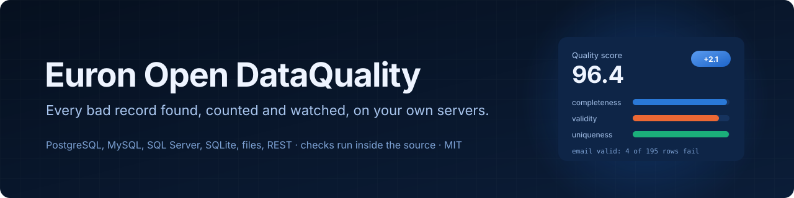
</p>

<p align="center">
  
  <a href="LICENSE"></a>
  
  
  
  
  
  
  
</p>

<p align="center">
  <a href="https://github.com/euron-sde-team/euron-open-dataquality/stargazers"></a>
  <a href="https://github.com/euron-sde-team/euron-open-dataquality/fork"></a>
  <a href="https://github.com/euron-sde-team/euron-open-dataquality/watchers"></a>
  <br>
  <a href="https://github.com/euron-sde-team/euron-open-dataquality/issues"></a>
  <a href="https://github.com/euron-sde-team/euron-open-dataquality/pulls"></a>
  <a href="https://github.com/euron-sde-team/euron-open-dataquality/commits/main"></a>
  
  <br>
  <a href="#built-by-the-team-behind-euron"></a>
</p>

<p align="center">
  <b><a href="#-quickstart">Quickstart</a></b> ·
  <b><a href="#️-architecture">Architecture</a></b> ·
  <b><a href="docs/architecture/checks.md">Checks</a></b> ·
  <b><a href="docs/guides/checks-as-code.md">Checks as code</a></b> ·
  <b><a href="docs/api/openapi.yaml">API reference</a></b> ·
  <b><a href="#️-deploy-to-aws">Deploy</a></b> ·
  <b><a href="docs/architecture/security.md">Security</a></b> ·
  <b><a href="#-documentation">Docs</a></b>
</p>

**Euron Open DataQuality** is an open-source, MIT-licensed, self-hosted data quality
platform, part of the open-source initiative of **ENGAGESPHERE TECHNOLOGY PRIVATE
LIMITED**. Connect a database (PostgreSQL, MySQL, SQLite, SQL Server), upload a file (CSV,
Excel, JSON, Parquet), point it at a REST endpoint, or push records from your own
application, and within seconds you see a profile of the data, a set of suggested checks
and a quality score that says exactly what is wrong: how many emails are missing, which
customer ids repeat, which phone numbers are invalid, which prices are negative, whether
yesterday's load arrived. Scans then run on a schedule, every result is kept, unusual
changes are flagged and the team is alerted when quality drops.

It is built for developers and data teams who want to catch bad records before an
application or a report does. What makes it different:

- **Checks run inside your database, not in memory.** Every check compiles to SQL in the
  source's own dialect and returns counts plus a few sample rows. Fifteen checks over a
  1,000,000 row PostgreSQL table take 4.5 seconds, and the worker's memory stays at 93 MB
  whether the table has 100,000 rows or 1,000,000. Files load into an embedded DuckDB and go
  through the same compiler, so a CSV and a table with the same defect report the same
  numbers: a golden dataset proves it on eight backends.
- **Read-only by construction.** It only ever generates `SELECT`, runs it in a read-only
  session wherever the database has one (a write attempted through it fails, tested on
  every engine), and refuses custom SQL that is not exactly one read-only `SELECT`.
  Passwords and REST headers are sealed with envelope encryption (KMS on AWS) and never
  returned.
- **Useful with zero AI.** Suggested checks come from the profile with plain rules;
  anomalies are robust statistics explained in a sentence ("Row count is 12,000, 90% below
  the typical 120,000"). An optional assistant turns plain language into a check, and it is
  off until an admin points it at any OpenAI-compatible model.
- **Yours to run and to automate.** One `make up`, no account anywhere; checks as code in
  YAML; a `dq` command that fails a CI build when quality drops; a REST API with scoped
  keys; Terraform for AWS.

<p align="center">
  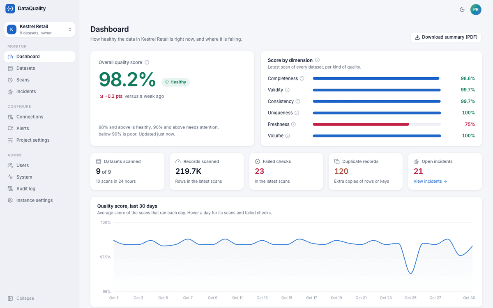
</p>

> [!NOTE]
> Everything in the tour ran for real: Docker Compose on a laptop, with S3, KMS and Secrets
> Manager emulated locally and provisioned by the same Terraform modules that build
> production. Every score, failing row and anomaly was computed by the engine against the
> demo PostgreSQL and MySQL databases, an Excel file, a Parquet file, a REST feed and
> pushed records. The demo seed replays 30 days of loads (quality slowly improving, one
> broken orders load, one burst of missing emails), runs real scans for each day and moves
> them to the day they stand for. The scan in the tour was started from the browser and
> followed live. `make up && make demo` reproduces it.

<h3 align="center">Built by the team behind Euron</h3>

<p align="center">Euron Open DataQuality comes from the people who build these platforms. If you like how this repository is built, come and see what we build with it.</p>

<p align="center">
  <a href="https://euron.one"><picture><source media="(prefers-color-scheme: dark)" srcset="docs/assets/brand/euron-dark.svg"></picture></a>
  <a href="https://euronsystems.com"><picture><source media="(prefers-color-scheme: dark)" srcset="docs/assets/brand/euron-systems-dark.svg"></picture></a>
  <a href="https://alphaeuron.com"><picture><source media="(prefers-color-scheme: dark)" srcset="docs/assets/brand/alpha-euron-dark.svg"></picture></a>
</p>

<p align="center">
  <a href="https://www.instagram.com/euron_official"></a>
  <a href="https://www.linkedin.com/company/euronone/posts/"></a>
  <a href="https://x.com/euron712"></a>
  <a href="https://www.youtube.com/@Euron-official"></a>
  <a href="https://whatsapp.com/channel/0029VaeeJwq9RZAfPW9P2l07"></a>
</p>

---

## 📚 Table of contents

- [Why DataQuality](#-why-dataquality)
- [At a glance](#-at-a-glance)
- [Screenshots](#️-screenshots)
- [Features](#-features)
- [Architecture](#️-architecture)
- [Tech stack](#-tech-stack)
- [Prerequisites](#-prerequisites)
- [Quickstart](#-quickstart)
- [Explore the repository](#-explore-the-repository)
- [API](#-api)
- [Configuration](#️-configuration)
- [Deploy to AWS](#️-deploy-to-aws)
- [Security model](#-security-model)
- [Testing](#-testing)
- [Documentation](#-documentation)
- [Roadmap](#️-roadmap)
- [FAQ](#-faq)
- [Contributing, security and license](#-contributing-security-and-license)

## 💡 Why DataQuality

Bad data rarely announces itself. A signup form starts saving blank emails, a nightly load
brings in a tenth of its rows, a partner feed changes a column's type, a price arrives
negative, and someone notices weeks later in a report or a support ticket. The tools that
catch this are either libraries you wire up yourself (Great Expectations, which pulls data
into memory and has had no hosted UI since GX Cloud closed in June 2026), no longer open
source (Soda Core moved to the Elastic License 2.0 with v4 in January 2026), tied to one
stack (dbt packages, Spark libraries), or SaaS products your data or its metadata has to
travel to.

DataQuality is the self-hosted platform in between: a product your team opens in the
browser, connected to your databases with a read-only login, that profiles, checks,
scores, remembers and alerts, without moving the data anywhere and without a bill per row.

## 📊 At a glance

| | |
| --- | --- |
| **Sources** | PostgreSQL, MySQL and MariaDB, SQLite (uploaded file), SQL Server; CSV, TSV, Excel, JSON, NDJSON and Parquet uploads with versions; REST endpoints; records pushed by your application |
| **Checks** | 16 types: not null, unique (single or composite), duplicate rows, schema, type, range, pattern (12 presets or a portable regex), allowed values, length, freshness, row count, reference exists, column comparison, consistent format, outliers, custom SQL |
| **Profiling** | Types, missing and blank values, distinct counts, min and max, mean and standard deviation, quantiles, histograms, top values, value shapes, semantic hints |
| **Scoring** | Six dimensions (completeness, validity, consistency, uniqueness, freshness, volume); a score per dataset and project, rounded down so 100% means nothing failed |
| **Monitoring** | Schedules (cron with time zone), 30 day trends, anomaly detection on row counts, missing values, failing rows and scores, schema drift between scans |
| **Alerts** | Email, Slack and HMAC-signed webhooks; one incident per problem, one notification, resolved automatically when a scan shows it gone |
| **Scale** | 15 checks over 1,000,000 PostgreSQL rows in 4.5 s; a 9 column profile in 9.8 s; worker memory flat at 93 MB |
| **Parity** | One golden dataset with planted defects gives identical counts in PostgreSQL, MySQL, SQLite, SQL Server, CSV, Excel, JSON and Parquet |
| **Tests** | 70 API unit, 54 integration (against real databases), 42 web unit, 9 browser end-to-end tests over 6 journeys and a 152 page view visual sweep |
| **Infrastructure** | Terraform for AWS (ECS Fargate, RDS, ElastiCache, S3, KMS, SES, CloudWatch), applied to a local emulator on every `make up` |

## 🖼️ Screenshots

<table>
  <tr>
    <td width="50%">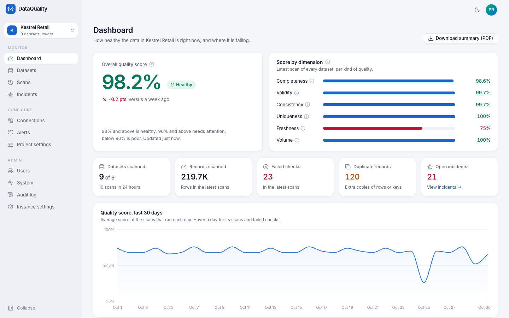<br><sub><b>Dashboard.</b> The project's score with its change over a week, the six dimensions, 30 days of trend, recent issues and the datasets that need attention.</sub></td>
    <td width="50%">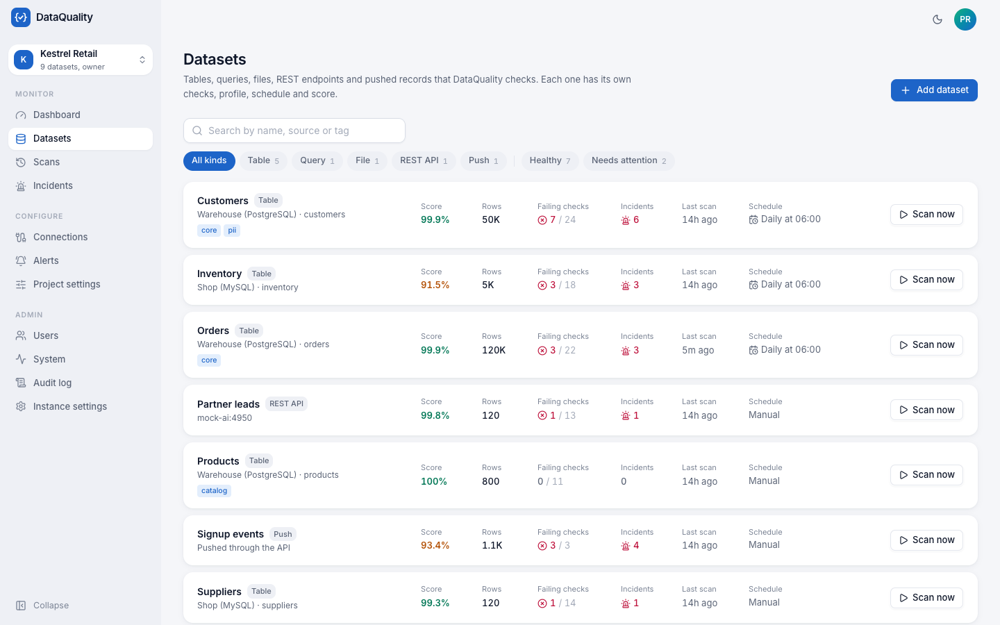<br><sub><b>Datasets.</b> Tables, a query, uploads, a REST feed and a push dataset, each with its score, failing checks and schedule.</sub></td>
  </tr>
  <tr>
    <td>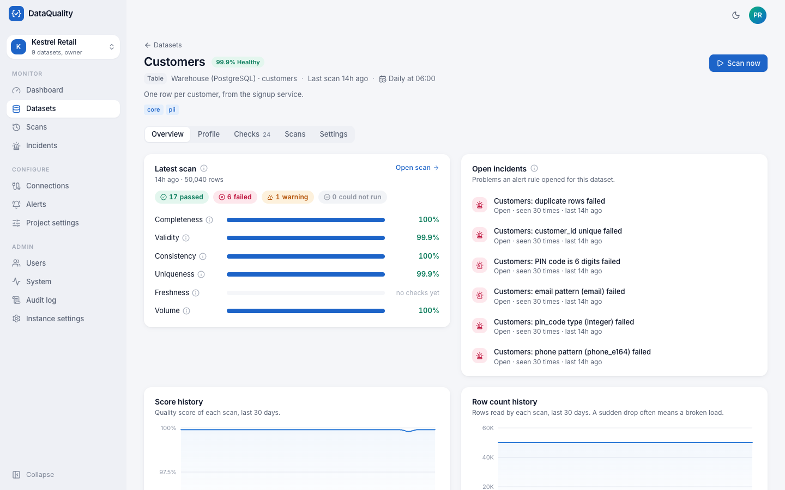<br><sub><b>A dataset.</b> Dimension scores, score and row count history, open incidents and recent anomalies.</sub></td>
    <td>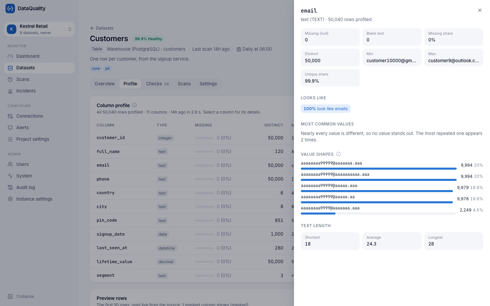<br><sub><b>Profile.</b> Every column computed inside the source: missing values, distinct counts, ranges, histograms, top values and value shapes.</sub></td>
  </tr>
  <tr>
    <td>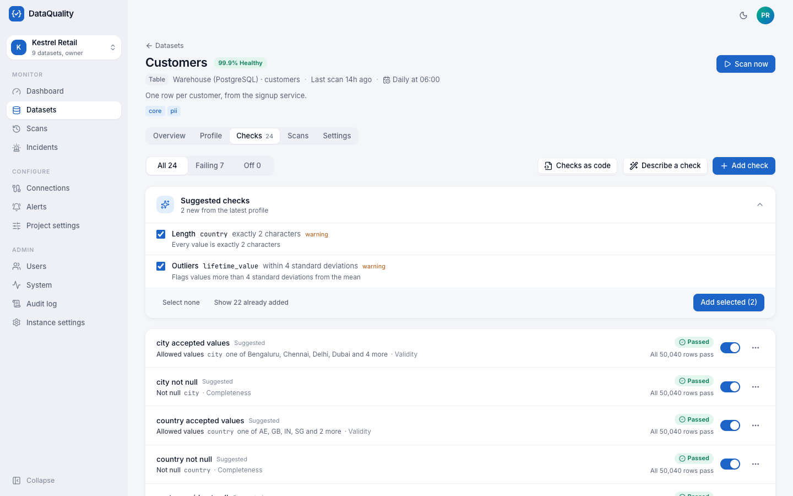<br><sub><b>Checks.</b> Each check in words with its latest result, plus checks suggested from the profile and checks as code.</sub></td>
    <td>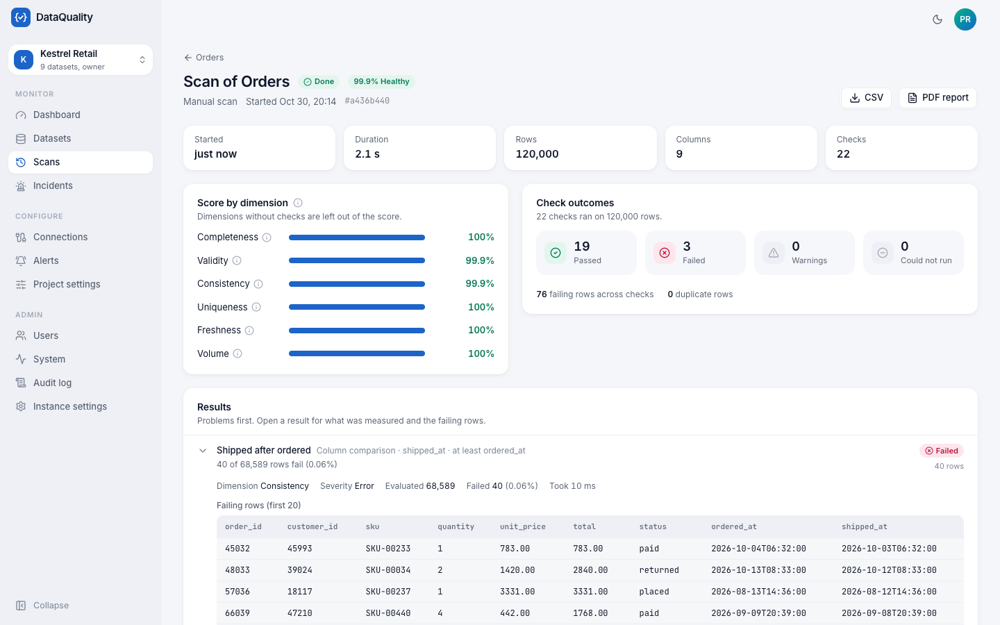<br><sub><b>A scan.</b> Failures first, each with its count, what was observed and the failing rows.</sub></td>
  </tr>
  <tr>
    <td>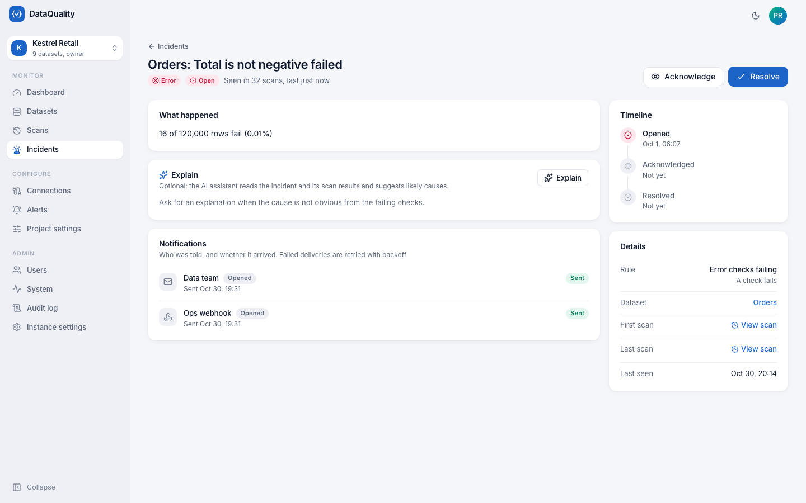<br><sub><b>An incident.</b> What broke, since when, how often, and every notification that went out.</sub></td>
    <td>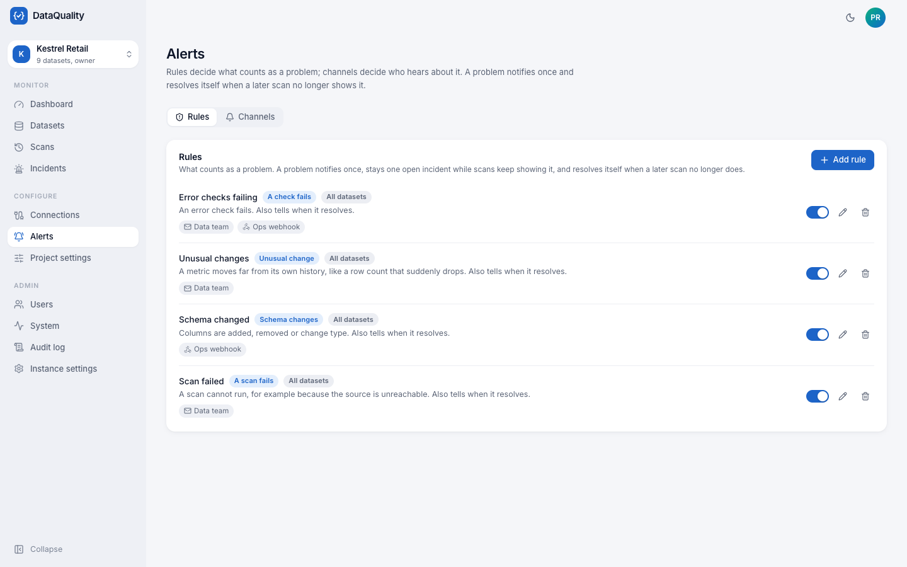<br><sub><b>Alerts.</b> Rules for failing checks, scores, anomalies, schema changes and failed scans, sent by email, Slack or a signed webhook.</sub></td>
  </tr>
  <tr>
    <td>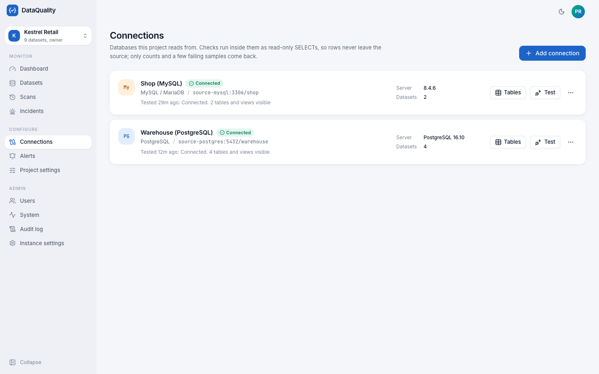<br><sub><b>Connections.</b> Read-only logins, tested in one click, with a table browser to add datasets.</sub></td>
    <td>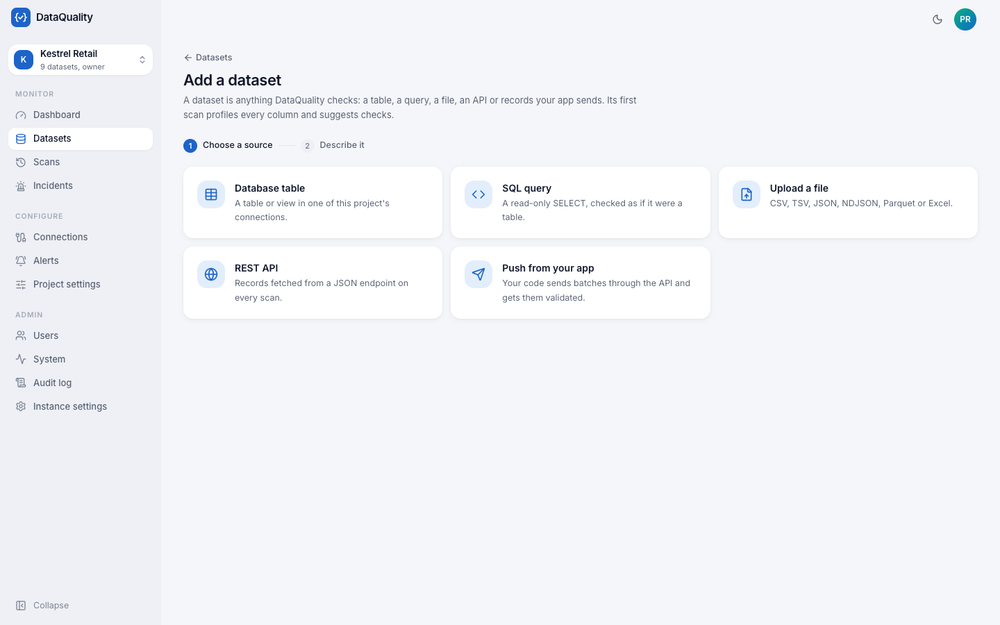<br><sub><b>Add a dataset.</b> A table, a query, a file, a REST endpoint or records your app pushes; the first scan profiles it.</sub></td>
  </tr>
  <tr>
    <td>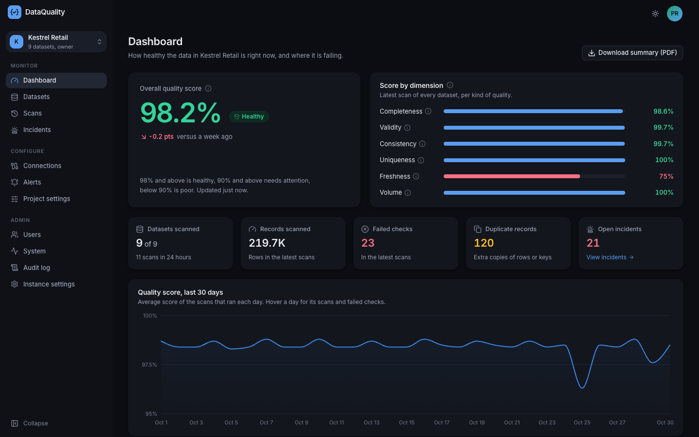<br><sub><b>Dark mode.</b> Every screen, in both themes.</sub></td>
    <td>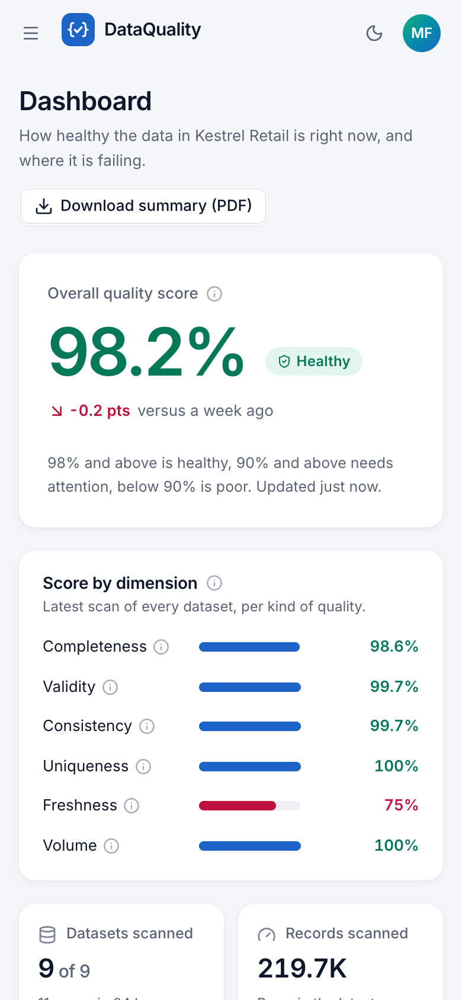<br><sub><b>On a phone.</b> Responsive down to phone width.</sub></td>
  </tr>
</table>

## ✨ Features

#### 🔎 Find what is wrong, exactly

- **Profiles in seconds.** Each column's type, missing and blank values, distinct count,
  range, mean, quantiles, histogram, most common values and value shapes ("99 AA 9999"),
  computed by the database; very large tables are profiled over their first rows while
  checks stay exact over every row.
- **Checks suggested from the data.** Not null where nothing is missing, unique for key
  columns, the email or phone pattern when nearly every value matches, allowed values for
  small categories, never negative for prices and quantities, freshness for timestamps, the
  schema as it is: each with its reason, accepted in one click.
- **Sixteen check types** with a severity, a tolerance (a count or a percent of rows), a
  filter and a quality dimension. Text compares exactly, `NULL` is never "invalid" (missing
  values are completeness's business) and regexes match whole values the same way on
  every engine.
- **Failing rows, not just counts.** Up to 200 samples per check (20 by default), with
  sensitive columns masked.

#### 📈 Keep watching

- **Schedules** with cron in any time zone; a scheduled scan runs once however many workers
  race for it, and a worker that dies mid-scan hands it to another.
- **History and trends** per dataset and project, kept after detailed results expire.
- **Anomalies** on row counts, missing values per column, failing rows per check and
  scores, with the reason in words; **schema drift** (a column added, removed or retyped)
  between scans.
- **Incidents and alerts.** One incident per problem, notified once to email, Slack or a
  signed webhook, counted while it lasts, resolved when it is gone.
- **Reports.** A scan as CSV or PDF, a dataset's history as CSV, a project summary as PDF.

#### 🔒 Safe with production data

- Read-only sessions, statement timeouts, a cap on concurrent scans per database, and a SQL
  guard that refuses anything but one `SELECT`.
- Sealed credentials (AES-GCM locally, KMS envelope on AWS), never returned by the API and
  never logged.
- Project roles (viewer, editor, owner), project API keys with scopes, an append-only
  audit log, and a 404 for every project you cannot see.

#### 🧩 Fits your workflow

- **Checks as code:** export and apply YAML, idempotently, with `prune` to remove what the
  file no longer lists.
- **`dq` in CI:** `dq scan customers --fail-on error` exits 1 when a check fails.
- **Push validation:** your application posts a batch of records and gets the results back.
- **Optional AI:** plain language to a check, and incident explanations, with any
  OpenAI-compatible model (including a local one). Raw values are sent only if the project
  allows it.

## 🏗️ Architecture

<p align="center">
  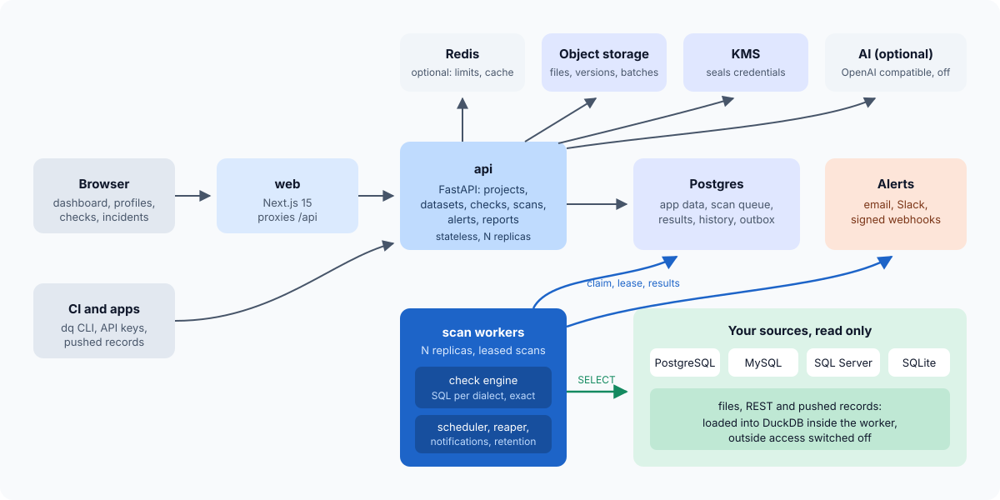
</p>

One Python package runs as two processes. The **API** serves the web app and the REST API.
The **worker** claims queued scans from PostgreSQL (`FOR UPDATE SKIP LOCKED`, with a lease
it renews), opens the source read-only in a thread, runs the checks and the profile, and
writes the results, history, anomalies and incidents in one transaction. It also runs the
scheduler, alert delivery and retention. Both are stateless; run as many of each as you
need.

<p align="center">
  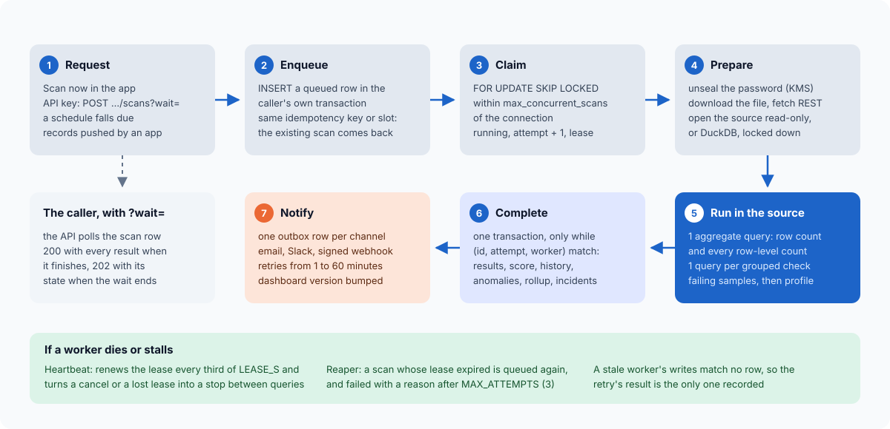
</p>

For one dataset, a scan runs **one aggregate query** that counts the rows and, for every
row-level check, the rows evaluated and the rows that fail, so the table is read once
however many checks it has. Grouped checks (unique, duplicate rows, consistent format),
statistics (outliers), references to another table and custom SQL follow with one query
each, then a bounded sample of failing rows per failing check. SQL Server has no regex, so
those checks stream one column and match in Python, still exactly.
[engine.md](docs/architecture/engine.md) has the per-dialect details.

## 🧰 Tech stack

| Layer | Choice |
| --- | --- |
| API and worker | Python 3.12, FastAPI, Pydantic v2, SQLAlchemy 2 (async for the app, sync drivers in threads for sources), Alembic |
| Engine | SQLAlchemy Core compiled per dialect, sqlglot (the SQL guard), DuckDB and Polars (files), reportlab (PDF) |
| Sources | psycopg, PyMySQL, pymssql, SQLite, DuckDB, httpx |
| Store | PostgreSQL 16 (app data, the scan queue, history), Redis 7 (rate limits and the dashboard cache; optional) |
| Web | Next.js 15, React 19, TypeScript, Tailwind v4, shadcn/ui, TanStack Query v5, Recharts |
| Infrastructure | Docker Compose, Floci (local AWS), Terraform (AWS) |
| Quality | ruff, mypy `--strict`, pytest, Vitest, Playwright, Puppeteer, tflint, checkov |

## 📋 Prerequisites

Docker (Docker Desktop on macOS or Windows, or Docker Engine with Compose v2) and `make`.
For running tests outside containers: [uv](https://docs.astral.sh/uv/) and
[pnpm](https://pnpm.io/). Nothing else is installed on the host.

## 🚀 Quickstart

```bash
git clone https://github.com/euron-sde-team/euron-open-dataquality.git
cd euron-open-dataquality
make up        # everything in Docker, AWS emulated by Floci, Terraform applied
make demo      # demo sources, projects, datasets, checks and 30 days of real scans
```

Open http://localhost:4910 and sign in as `admin@dataquality.demo` with the
`DQ_DEMO_PASSWORD` that `make env` wrote to `deploy/compose/.env`. `maya@dataquality.demo`
is an editor and `arjun@dataquality.demo` a viewer. Alert emails land in Mailpit at
http://localhost:4925, and the API documentation is at http://localhost:4930/docs.

On a fresh install without the demo, the first account you create becomes the admin.

```bash
# Scan from a terminal or CI with a project API key (Project settings, API keys):
export DQ_URL=http://localhost:4930 DQ_API_KEY=dq_... DQ_PROJECT=<project id>
cd apps/api && uv run dq scan customers --fail-on error
```

## 🧭 Explore the repository

```
apps/api/src/dataquality/
  engine/       the check engine: spec, compiler, dialects, runner, profiler, scoring,
                anomalies, suggestions, the SQL guard. No app code, unit-tested on DuckDB
  sources/      read-only sessions per database, DuckDB for files, REST
  scans/        the queue, the worker's executor, results, history, reports, tasks
  alerts/       rules, incidents, the notification outbox and delivery
  datasets/ checks/ connections/ projects/ dashboard/ ai/ auth/ users/ org/ audit/
  client/cli.py the dq command
apps/web/       the Next.js app (features/<domain>/ for each screen)
e2e/            Playwright journeys
infra/          Dockerfiles and Terraform (modules, envs/local-floci, aws-dev, aws-prod)
deploy/compose/ the local stack, with the demo source databases
scripts/        env, sanitization, test matrix, tf-aws-on-floci, backup, QA and screenshots
docs/           architecture, decisions, guides and the OpenAPI document
```

## 🔌 API

Every screen uses the same REST API, documented at `/docs` and in
[docs/api/openapi.yaml](docs/api/openapi.yaml). Applications and CI use a project API key
(`Authorization: Bearer dq_...` or `X-API-Key`) with the scopes `read`, `scan`, `push` and
`manage`.

```bash
# Scan and wait for the result (up to 300 s); 200 with every check's result.
curl -X POST -H "X-API-Key: $KEY" "$URL/api/v1/projects/$P/datasets/$D/scans?wait=120"

# Validate a batch of records from your application.
curl -X POST -H "X-API-Key: $KEY" -H "content-type: application/json" \
  -d '{"records": [{"email": "asha@example.com", "plan": "pro"}]}' \
  "$URL/api/v1/projects/$P/datasets/$PUSH/records?wait=30"
```

[api-integration.md](docs/guides/api-integration.md) covers keys, idempotency keys, errors
and limits; [checks-as-code.md](docs/guides/checks-as-code.md) the YAML format and a GitHub
Actions example.

## ⚙️ Configuration

Everything is set with environment variables, validated at startup; production refuses to
boot with demo secrets, local storage, mail that goes nowhere or cookies without `Secure`.
The full reference is [configuration.md](docs/guides/configuration.md). The ones you will
touch first:

| Variable | Default | What it does |
| --- | --- | --- |
| `DATABASE_URL` | local | The app's PostgreSQL |
| `REDIS_URL` | empty | Shared rate limits and dashboard cache; optional |
| `KEY_MODE`, `KMS_KEY_ID` | `local` | Seal credentials with a local key or AWS KMS |
| `STORAGE`, `OBJECTS_BUCKET` | `local` | Uploaded files on disk or in S3 |
| `MAIL_BACKEND` | `log` | Alert email by `smtp` or `ses` |
| `SOURCE_ALLOW_PRIVATE` | `true` | Databases on private networks (metadata addresses are always refused) |
| `STATEMENT_TIMEOUT_S` | `300` | Per-statement timeout on source databases |
| `WORKER_CONCURRENCY` | `4` | Scans one worker runs at once |

## ☁️ Deploy to AWS

`infra/terraform` holds modules for the network, RDS PostgreSQL, ElastiCache, S3, KMS,
Secrets Manager, SES, ECR, ECS Fargate services (API, worker, web) behind an ALB with WAF,
and CloudWatch alarms (failed scans, re-queued scans, the scan backlog, errors). `aws-dev`
and `aws-prod` compose them; `make aws-deploy ENV=aws-dev TAG=0.1.0` builds and pushes the
images, applies, migrates and waits for the services. This repository never applies to a
real account itself: the same `aws-dev` environment is planned, applied, re-planned and
destroyed against a throwaway emulator by `make tf-aws-on-floci`. Read
[deploy-aws.md](docs/guides/deploy-aws.md) first.

## 🔐 Security model

- **Sources are read-only** by session where the database supports it, by the SQL guard
  everywhere, and by the login you give it (use one that can only read).
- **Credentials are sealed** with the record id as encryption context, so a sealed value
  moved to another row does not open.
- **Outbound calls are checked** at connect time: no instance metadata ever, no private
  addresses for webhooks and REST feeds unless allowed.
- **Sessions** are HttpOnly cookies with a CSRF header requirement, revocable server-side;
  sign-in is rate limited with an account lockout; API keys are peppered hashes.
- **Every change is audited** in an append-only log that the database itself protects.

[security.md](docs/architecture/security.md) and the STRIDE
[threat model](docs/architecture/threat-model.md) go further.

## 🧪 Testing

| Suite | Count | What it proves |
| --- | --- | --- |
| API unit | 70 | The engine on in-process DuckDB and SQLite (every check, the golden counts, the SQL Server Python path), the SQL guard, dialect SQL, scoring, anomalies, suggestions, config guards |
| API integration | 54 | Every endpoint against real PostgreSQL, Redis and source databases: the golden dataset on 8 backends, read-only enforcement, sealing, queue crashes and racing schedulers, alerts end to end, reports, roles, API keys, the `dq` CLI, the optional AI against a mock model |
| Web unit | 42 | Navigation, roles, formatting and quality vocabulary |
| Browser end to end | 9 | Six journeys: the five-minute path from upload to a caught defect, databases, the dashboard against the API, alerts, a viewer's read-only view, sign in |
| Browser QA | 152 | Every page as admin, editor and viewer, light and dark, desktop and phone: no console errors, failed requests, broken images or horizontal overflow |
| Infrastructure | | `terraform validate` and tflint on every environment, checkov (316 passed, 0 failed), the full `aws-dev` plan, apply, re-plan and destroy against an emulator |

```bash
make test               # unit tests, no services
make test-integration   # real databases in Docker (MSSQL=1 adds SQL Server)
make test-matrix        # integration under local and KMS keys, local and S3 storage
make e2e qa             # browser journeys and the visual QA sweep (after make up && make demo)
make bench              # the 1,000,000 row benchmark
```

API coverage is 89% over unit and integration tests. [testing.md](docs/guides/testing.md)
explains each suite.

## 📖 Documentation

| Architecture | Guides |
| --- | --- |
| [High-level design](docs/architecture/HLD.md) | [Quickstart (local)](docs/guides/quickstart-local.md) |
| [Low-level design](docs/architecture/LLD.md) | [Walkthrough of the demo](docs/guides/walkthrough.md) |
| [Checks](docs/architecture/checks.md) | [Checks as code and CI](docs/guides/checks-as-code.md) |
| [The engine](docs/architecture/engine.md) | [API integration](docs/guides/api-integration.md) |
| [Scoring](docs/architecture/scoring.md) | [Configuration reference](docs/guides/configuration.md) |
| [Anomalies](docs/architecture/anomalies.md) | [Deploy to AWS](docs/guides/deploy-aws.md) |
| [Alerts](docs/architecture/alerts.md) | [Local against real AWS](docs/guides/local-with-aws.md) |
| [The scan queue](docs/architecture/queue.md) | [Operations runbook](docs/guides/operations.md) |
| [Data model](docs/architecture/data-model.md) | [Testing](docs/guides/testing.md) |
| [Security](docs/architecture/security.md), [threat model](docs/architecture/threat-model.md) | [Troubleshooting](docs/guides/troubleshooting.md) |
| [Decision records](docs/architecture/adr/) | [Build plan](docs/PLAN.md) |
| [API reference (OpenAPI)](docs/api/openapi.yaml) | [Changelog](CHANGELOG.md) |

## 🗺️ Roadmap

- Connectors for MongoDB, BigQuery, Snowflake, Redshift and Databricks
- dbt and Airflow integrations; import of Great Expectations suites
- Seasonal anomaly models and column-level lineage
- SSO (OIDC), PagerDuty and Microsoft Teams channels
- Data contracts between producers and consumers

Have an idea? [Open a feature request](https://github.com/euron-sde-team/euron-open-dataquality/issues/new/choose).

## ❓ FAQ

<details>
<summary><b>Will a scan slow down my production database?</b></summary>

A scan is a handful of aggregate queries, each bounded by a statement timeout, and each
connection allows at most `max_concurrent_scans` scans at once (2 by default). Point it at
a read replica if you have one, and schedule heavy datasets outside peak hours.
</details>

<details>
<summary><b>Does my data leave my servers?</b></summary>

No. Checks run in your database; only counts, a bounded sample of failing rows (masked
columns hidden) and profile statistics are stored, in your own PostgreSQL. Nothing is sent
anywhere unless you turn on the optional AI assistant, and even then raw values are sent
only if the project allows it.
</details>

<details>
<summary><b>Why not Great Expectations or Soda Core?</b></summary>

GX Core is a library that pulls data into memory and has no hosted UI since GX Cloud
closed; Soda Core moved to the Elastic License 2.0 in v4, so it cannot ship in an MIT
project. DataQuality compiles checks to SQL that runs in your database and is a whole
product: UI, schedules, history, alerts, API. [ADR 0004](docs/architecture/adr/0004-own-check-engine.md)
has the reasoning.
</details>

<details>
<summary><b>Does it need an AI provider?</b></summary>

No. Profiling, suggestions, checks, scores and anomalies use no model at all. The optional
assistant is off by default and works with any OpenAI-compatible endpoint.
</details>

<details>
<summary><b>How big a table can it check?</b></summary>

Measured on a laptop (Apple silicon, PostgreSQL 16 in Docker): 15 checks over 1,000,000
rows in 4.5 s and a profile of its 9 columns in 9.8 s, with the worker at 93 MB, the same
as for 100,000 rows. The work is in the database, so time grows with the table and memory
does not. Very large tables are profiled over their first 5,000,000 rows
(`PROFILE_MAX_ROWS`); checks always read every row.
</details>

<details>
<summary><b>Do I need an AWS account to try it?</b></summary>

No. `make up` runs everything on Docker, with S3, KMS and Secrets Manager on a local
emulator provisioned by the same Terraform modules as production.
</details>

## 🤝 Contributing, security and license

Contributions are welcome: read [CONTRIBUTING.md](CONTRIBUTING.md) and the
[code of conduct](CODE_OF_CONDUCT.md). Report security issues privately as described in
[SECURITY.md](SECURITY.md).

Released under the [MIT License](LICENSE). Copyright (c) 2026 ENGAGESPHERE TECHNOLOGY
PRIVATE LIMITED and the Euron Open DataQuality contributors.

<p align="center">
  If DataQuality caught a bad load before your users did, <b><a href="https://github.com/euron-sde-team/euron-open-dataquality/stargazers">⭐ star the repository</a></b>.
</p>
