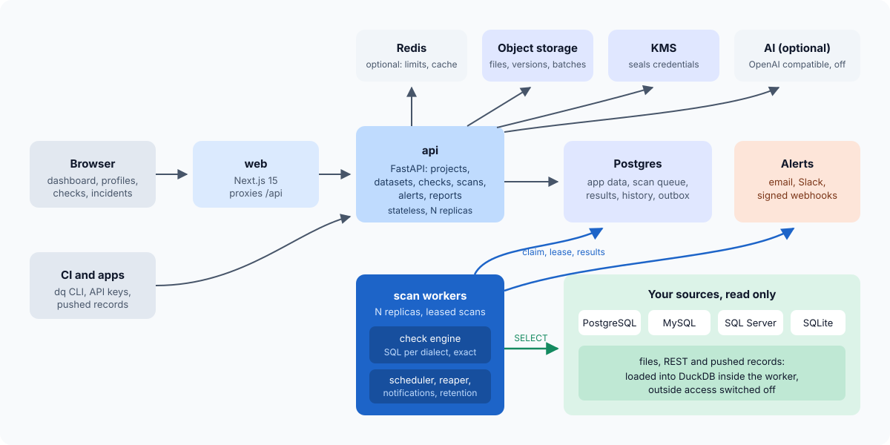
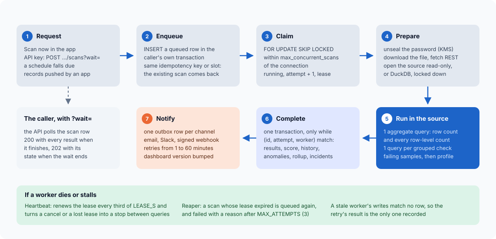

# High-level design

Euron Open DataQuality is a self-hosted data quality platform. A team connects a database
(PostgreSQL, MySQL or MariaDB, SQL Server, or an uploaded SQLite file), uploads a file (CSV,
TSV, JSON, NDJSON, Parquet, Excel), points it at a REST endpoint, or pushes records from an
application. The platform profiles the data, suggests checks from the profile, runs every
check as SQL inside the source, counts the failing records exactly, scores the result, keeps
the history, flags unusual changes and alerts the team. Nothing leaves the deployment except
the alerts it sends and, when an admin turns it on, prompts to an AI model of their choice.

## Goals and non-goals

| Goals | Non-goals (0.1.0) |
| --- | --- |
| Every record that breaks a declared rule is found and counted exactly, on every supported source | Estimated or sampled check results: profiles may sample a very large table, checks never do |
| Checks run where the data lives, so worker memory does not grow with the table | Copying source data into the platform, or a data warehouse of its own |
| The platform cannot write to a source: generated SQL is `SELECT` only, custom SQL is parsed and refused unless it is one read-only query, sessions are read-only where the database allows | Write-back, data repair or quarantine of bad rows |
| Useful with zero AI: suggestions and anomaly detection are deterministic rules and statistics | ML monitors, seasonal models, lineage |
| One install per organisation, several projects with roles and scoped API keys | Multi-tenant SaaS, SSO (OIDC, SAML) |
| Checks as code and a CLI that fails a CI build | dbt, Airflow, Great Expectations suite import (roadmap) |

## Components

| Component | What it does | Where |
| --- | --- | --- |
| Web app (`web`) | Next.js 15: dashboard, datasets, profiles, checks and suggestions, scans and failing samples, connections, alerts, incidents, project settings, admin. Proxies `/api/*`, `/healthz`, `/readyz`, `/docs` and `/openapi.json` to the API, so the browser talks to one origin with an HttpOnly session cookie | `apps/web/` |
| API (`api`) | FastAPI. `/api/v1/*` for the web app, scripts and API keys. Validates every check, queues scans, serves results, history, reports and the dashboard. Opens a source only for interactive work: connection tests, table lists and dataset previews | `apps/api/src/dataquality/` (one package per domain) |
| Scan worker (`worker`) | Claims queued scans from Postgres, opens the source read-only, runs checks and the profile, writes results, history, anomalies and incidents. Also runs the periodic tasks: scheduler, lease reaper, notification delivery, retention and queue gauges | `dataquality/worker.py`, `scans/`, `engine/`, `sources/` |
| Postgres | Everything durable, including the scan queue, results, the metric history, incidents and the notification outbox | RDS PostgreSQL 16 on AWS |
| Redis (optional) | Rate limit windows, the dashboard cache and its version counters. Nothing durable: without `REDIS_URL` both live in process memory | ElastiCache on AWS |
| Object storage | Uploaded files and their versions, pushed batches, uploaded SQLite databases. Rows keep only the key | Local disk or S3 (Floci locally) |
| KMS | Seals source passwords, REST headers, Slack and webhook URLs, webhook signing secrets and the AI key; encrypts the bucket | Local AES-GCM key or KMS (Floci locally) |
| Mail | Alert emails | Mailpit locally, any SMTP relay, or SES on AWS |
| Sources | The customer's databases, reached read-only, and DuckDB inside the worker for files, REST and push data | Customer networks |

One Python package holds the API, the worker and both CLIs (`dataquality` for the server,
`dq` for CI). One image runs all of them; the command decides the role.

## A scan, end to end

1. A scan is requested: a person presses **Scan** (`trigger=manual`), an API key calls
   `POST /api/v1/projects/{p}/datasets/{d}/scans` (`api`), the scheduler finds a due
   dataset (`schedule`), or an application pushes records (`push`). The API checks the
   project's scan rate limit (`SCAN_RPM`, not applied to pushes).
2. `queue.enqueue` inserts a `queued` row in `scans` in the caller's transaction. A repeated
   idempotency key, or a schedule slot that already has a scan, returns the existing row
   (unique constraints, `ON CONFLICT DO NOTHING`). Creating and queueing a scan is one commit.
3. A worker claims the oldest queued scan with `FOR UPDATE SKIP LOCKED`, skipping scans
   whose connection already runs `max_concurrent_scans`, sets it `running` with a lease, and
   commits. See [queue.md](queue.md).
4. `datasets/source.prepare` (async) opens sealed secrets, downloads the file version to a
   private temp directory or fetches the REST records, and checks the host as it resolves.
   `with_relation` (in a thread) opens the source read-only with a statement timeout, or an
   in-memory DuckDB with the files loaded and outside access switched off, and describes the
   relation. See [engine.md](engine.md).
5. The check runner compiles every enabled check to SQL for the source's dialect and runs
   them: one aggregate query for the row count and every row-level count, then one query per
   grouped, shape, outlier, reference or custom check, then a single streamed pass for regex
   checks on SQL Server, and a bounded sample of failing rows for each failing check. The
   profiler runs after the checks when the scan profiles. A heartbeat renews the lease every
   third of its length and stops the engine between queries on cancel or a lost lease.
6. `scans/complete.complete` writes everything in one transaction that commits only if the
   worker still owns the scan: check results, the profile, the score, metric points,
   anomalies, schema drift, the daily rollup, the dataset's latest state, and (in a
   savepoint) incidents and the notification outbox. See [alerts.md](alerts.md).
7. The worker bumps the project's dashboard version counter, so the next dashboard load is
   recomputed. The notification task sends the outbox rows: email, Slack, or a signed
   webhook, with retries.

A caller that wants the result in one request adds `?wait=<seconds>` (up to 300): the API
polls the scan row until it finishes or the wait runs out.

## Where the checks run

Every check becomes a SQL expression for the source's own dialect (`postgresql`, `mysql`,
`sqlite`, `mssql`, `duckdb`) and comes back as counts and a bounded sample. The worker never
loads a table into memory, so a 1,000,000 row table is checked with a handful of aggregate
queries. On 1,000,000 PostgreSQL rows, 15 checks took 4.5 s and a 9 column profile 9.8 s,
with the worker's peak memory at 93 MB for both 100,000 and 1,000,000 rows (`make bench`,
laptop, Apple silicon, Docker Postgres 16). Files are loaded into an embedded DuckDB and
checked by the same compiler, so a CSV and a Postgres table with the same defects report the
same numbers ([ADR-0001](adr/0001-checks-run-as-sql-in-the-source.md),
[ADR-0003](adr/0003-duckdb-for-files.md)).

## Caching

Every cache layer, what it holds and how it is invalidated:

| Layer | What | Where | Key | TTL | Invalidation |
| --- | --- | --- | --- | --- | --- |
| Dashboard | The computed project dashboard (score, counts, dimensions, 30 day trend, recent issues, worst datasets) | KV store: Redis when `REDIS_URL` is set, otherwise process memory | `dash:<project>:<version>`, where `<version>` is the value of the counter `dash:v:<project>` | 30 s (`CACHE_TTL_S`) | The worker increments `dash:v:<project>` after every scan it runs (success or failure), so the next load misses and recomputes. The TTL bounds staleness when the counter is unavailable (see the note below) |
| Denormalised latest state | `last_scan_id`, `last_scan_at`, `last_status`, `last_score`, `last_row_count`, `last_failed_checks` on `datasets` | Postgres | the dataset row | none | Written in the scan's completion transaction, so the dataset list and the dashboard never scan results history |
| Daily rollup | `daily_scores`: scans, score sum, last score, failed checks, rows scanned per dataset and day | Postgres | `(dataset_id, day)` | none (a table) | Upserted in the completion transaction (`ON CONFLICT DO UPDATE`); the dashboard trend reads only this table |
| Reference relations | Reflected tables named by referential checks | Worker memory, per scan | the reference name | the scan | Discarded when the scan's connection closes |
| Rate limits | Sliding window counters (Redis) or fixed window counters (memory) for login, sign-up and scan requests | KV store | `dq:rl:<name>:<window>` | two windows | Expire on their own |
| API key last use | `last_used_at` on `api_keys` | Postgres | the key | written at most every 5 minutes per key | Not a cache of results: it limits writes on the hot authentication path |
| HTTP | `Cache-Control: no-store` on sign-in and sign-up responses (they carry a session token). Reports and API responses set no cache headers | n/a | n/a | n/a | n/a |
| Web | TanStack Query with deliberate `staleTime` per kind of data (`apps/web/src/lib/query-keys.ts`): `live` 3 s (scans, a scan, incident detail, admin system), `list` 15 s (datasets, checks, connections, channels, rules, dashboard), `config` 30 s (settings, users, audit, a dataset's profile and suggestions), `static` 5 minutes (who is signed in) | Browser | query keys under `["p", projectId, ...]` | per query | Mutations invalidate the keys they touched; scan lists poll every 2 to 2.5 s and a scan page every 1.5 s while a scan is queued or running; the dashboard refetches every 60 s |

Notes on correctness:

- **Version counter in memory mode.** Without Redis, the API and the worker each have their
  own process memory, so the worker's increment does not reach the API's cache: a new
  result shows on the dashboard within the 30 second TTL instead of at once. Run Redis when
  you want immediate invalidation; both Compose stacks and the AWS environments do.
- **Redis eviction.** The local Redis and the `cache` module use `allkeys-lru`. An evicted
  version counter reads as `0`; any entry cached under that version expires within 30 s, so
  staleness stays bounded by the TTL. Nothing that must not be lost lives in Redis: the
  queue, sessions, revocations and lockouts are in Postgres.
- **Cache errors are misses.** A Redis error while reading or writing the dashboard cache
  costs a recompute, never a failed request.

## Deployment shapes

| Shape | How | Use |
| --- | --- | --- |
| Local, emulated AWS | `make up`: Compose with Floci provisioned by the same Terraform modules (`envs/local-floci`) | Development, evaluation, the demo |
| Local against real AWS | `make up-aws` with `deploy/compose/.env.aws` | Testing S3, KMS and SES code paths with a real account |
| AWS | `make aws-deploy`: ECS Fargate (api, worker, web) behind an ALB, RDS, ElastiCache, S3, KMS, SES, CloudWatch | Production ([deploy-aws.md](../guides/deploy-aws.md)) |

## Scaling

| What | How it scales |
| --- | --- |
| API, web | Stateless; run N replicas. Waiting requests (`?wait=`) poll Postgres and hold no lock |
| Scan workers | N replicas, each running up to `WORKER_CONCURRENCY` scans at once. Claims use `SKIP LOCKED`, so workers never wait on each other; `max_concurrent_scans` per connection protects each source database |
| Scheduler, reaper, delivery, retention | Run inside every worker; each task claims its rows with `SKIP LOCKED` or conditional updates, so replicas never duplicate work |
| Sources | The work is SQL in the source: a scan's cost is a few aggregate queries plus one per grouped check. Worker memory stays flat (see the benchmark above) |
| Postgres | One query per list; partial indexes for the queue, leases, due schedules, open incidents and due notifications; dashboards read the rollup and denormalised state |

## Observability

Structured JSON logs with request ids; Prometheus `/metrics` on the API and on the worker
(`WORKER_METRICS_PORT`, 9464 by default); `/healthz` and `/readyz`; optional OpenTelemetry
tracing (`OTEL_ENABLED`). Metric names and the AWS alarms are in
[operations.md](../guides/operations.md).
